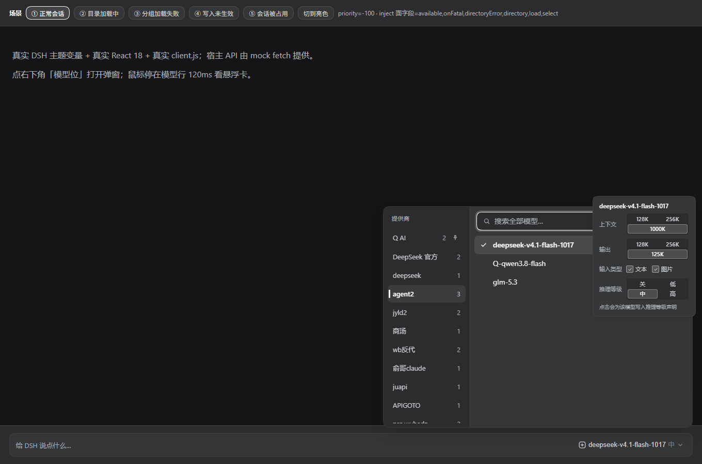
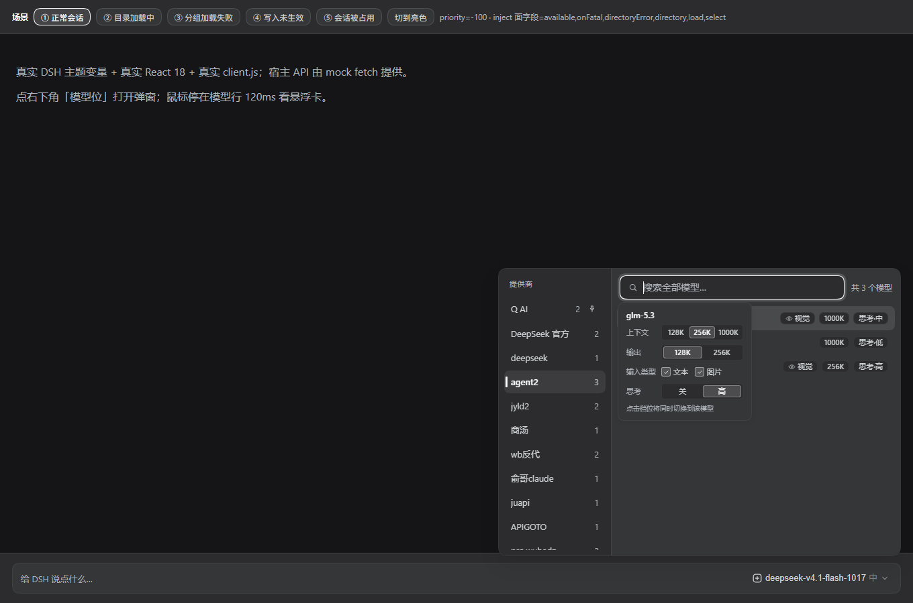
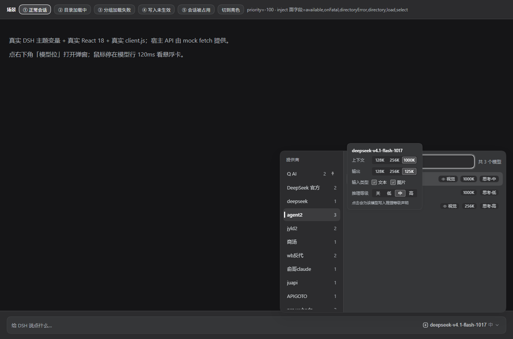
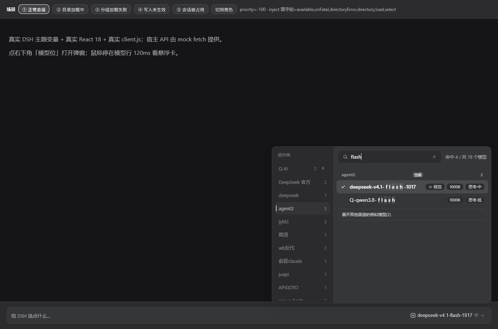
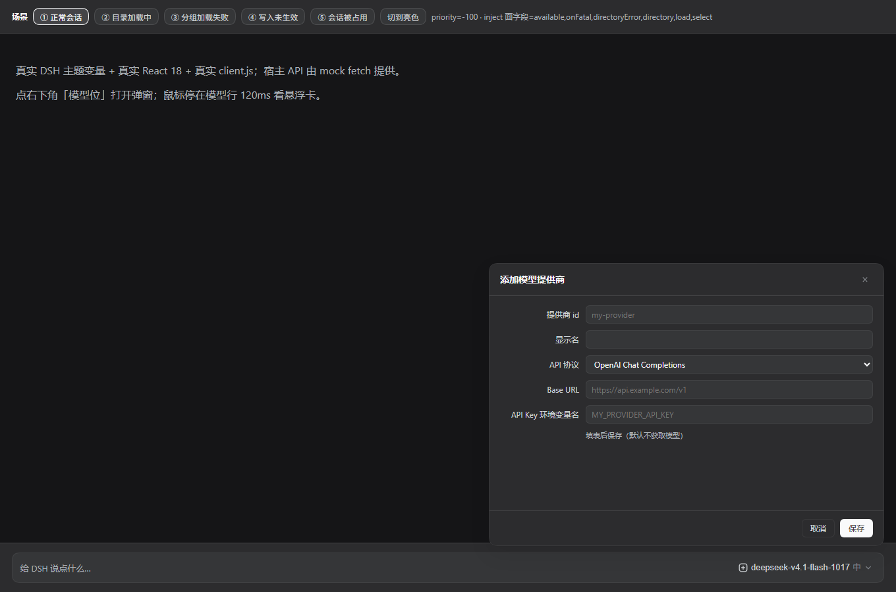
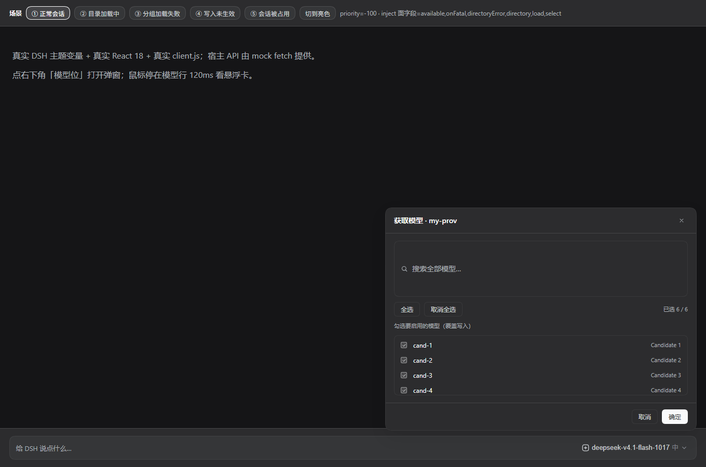
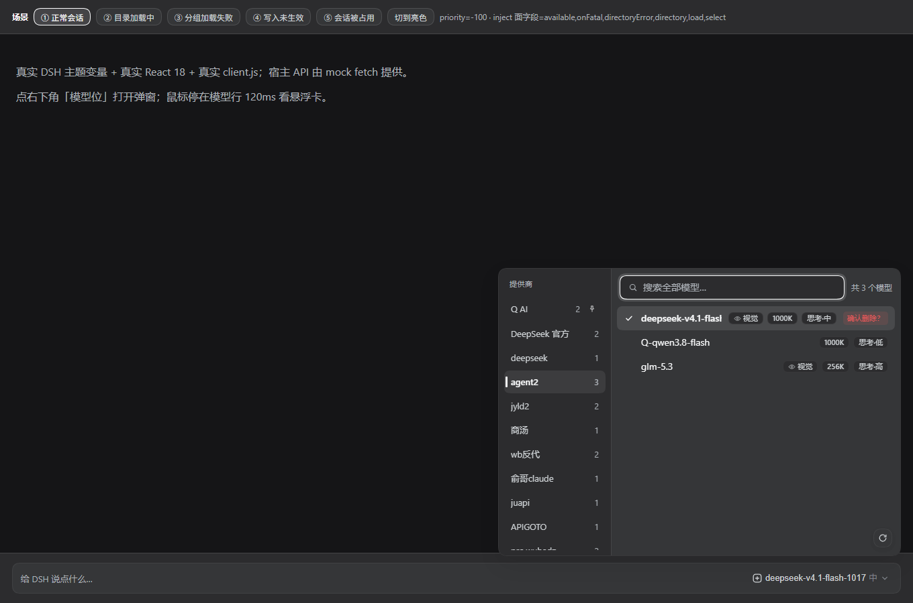

# dsh-model-hub

**给 DeepSeek Harness 用的模型中心插件。** 把输入框上那个「又长又平、几十个模型挤一起」的模型列表，换成 **双栏 + 悬浮能力卡**，并且**能直接在面板里管理提供商和模型**。

技术特点：**零构建、零 npm 依赖**（React 由宿主提供）—— 仓库里就是可直接安装的成品，不需要 `npm install`，不需要打包。



> 适配版本：DSH 桌面版 `0.2.1-rc.2`（2026-10-23 实测，见下方「验证状态」）。

---

## 功能总览

### 模型选择

- **双栏布局**：左 = 提供商（拖拽排序 / 置顶 / 持久化；只显示「有模型或已声明」的，其余隐藏），右 = 模型列表。
- **搜索跨全部提供商**：当前提供商的命中排最前；右栏底部可「展开其他渠道的相似模型」。
- **悬浮能力卡**（200px，跟随鼠标出现后**钉住**，可以移上去继续操作）：
  - 上下文档位：128K / 256K / 1000K
  - 输出档位：128K / 256K
  - 输入类型：文本 / 图片（与设置页同款）
  - 推理等级：关 / 低 / 中 / 高（固定四档，与设置页档位数量一致）
- **非标准值会标注并高亮**：例如在设置页手打了一千万，卡片会警示「确认是否多打了 0」。

### 提供商与模型管理

- 左栏底部「**＋ 添加模型提供商**」：全屏表单（id / 显示名 / API 协议 / Base URL / Key 环境变量名），有取消与 × 退出。
- 保存后**默认不获取模型**；该渠道以「待选模型」状态出现在左栏（草稿存在插件自己的 `prefs.json`，**不动 DSH 配置**），可删除。
- 模型列表**右下角刷新按钮** → 询问端点有哪些模型 → 候选界面（**可搜索、可勾选、全选/取消全选**）→ 确定才把「渠道 + 勾选模型」**一次性原子落盘**。
- **单个模型删除**（hover 出现、二次确认）；只剩最后一个可删模型时按钮置灰；删掉后用刷新即可加回来。

### 可靠性（不是「看着对」，是回读确认过）

- 能力改动写进模型配置后**回读运行时确认**；写不进或没生效 → 明确报 `NOT_EFFECTIVE` 并回滚。
- 渲染失败会**自动让出槽位**、交回内置选择器并给可见提示（不白屏、不「点了没反应」）。
- 亮 / 暗主题、`prefers-reduced-motion`、键盘操作（↑↓ / Enter / Esc / Tab）。

---

## 截图

|  |  |
|---|---|
|  |  |
| 输入类型（文本 / 图片） | 推理等级四档 |
|  |  |
| 搜索 + 展开其他渠道 | 添加模型提供商（全屏表单） |
|  |  |
| 获取模型（勾选 / 全选 / 取消全选） | 删除单个模型（二次确认） |

> 如实标注：这些**是用真实 `client.js` + 真实 DSH 主题变量在 mock 宿主里渲染的预览图，不是真机截图**。

---

## 安装

### 方式一：官方 CLI / GUI（推荐）

```powershell
# 从 GitHub 安装
dsh plugin --profile desktop add github:<账号>/dsh-model-hub
dsh plugin --profile desktop add github:<账号>/dsh-model-hub#v0.1.0

# 本地目录（开发）
dsh plugin --profile desktop add "<本目录绝对路径>"
```

`dsh` 不在 PATH 时用安装目录里的 CLI，或直接走 GUI：

```powershell
& "<DSH 安装目录>\resources\runtime\cli\bin\dsh.cmd" plugin --profile desktop add <spec>
# GUI：侧边栏「插件」→ 添加插件 → 粘贴包名 / Git 地址 / 压缩包 / 本地绝对路径
```

### 方式二：可审计脚本（本仓库 `tools/`）

```powershell
pwsh -File tools\install.ps1 -DryRun   # 先看将要改什么（只预览，不写）
pwsh -File tools\install.ps1           # 安装：备份 → 改两处 → pnpm install → 回读校验
pwsh -File tools\uninstall.ps1         # 卸载（-DisableOnly 只关不卸）
```

脚本自带**越界拒绝**：JSON diff 只允许落在 `dependencies.<包名>` 与 `dsh.profile.bundles`，其它键变了就拒绝写；卸载后 `cordis.patch.yml` 与 `package.json` 逐字节复原（沙箱往返 27/27 已验证）。详见 [`tools/README.md`](tools/README.md)。

---

## 装完之后怎么生效（重要）

| 场景 | 需要做什么 |
|---|---|
| **宿主侧 API**（`/model-hub/api/*`） | 安装即生效，**不需要重启**（实测：路由 404 → 200，正在运行的宿主直接激活） |
| **客户端 UI**（输入框上的模型位） | **刷新页面一次**（桌面端 `Ctrl+Shift+R`）—— 页面的启动清单在加载时生成，刷新才会带上新插件 |
| **插件自身的宿主代码更新**（升级版本后） | 需要**重启 DSH**（没有 HMR 时，Node 模块不会热重载）；客户端半边刷新页面即可 |

> 桌面端没有 HMR，`lib/host/*` 不会热重载 —— 这条踩过好几次：接口 404、字段读不到，都是「没重启」，看起来完全像 bug。

关掉插件而不用卸载：把 `cordis.patch.yml` 里的 `enabled` 改成 `false` —— 宿主 API 停用、客户端条目不再注册，**内置模型选择器原样恢复**（无 CSS / DOM 残留）。

---

## 使用

| 操作 | 结果 |
|---|---|
| 点击输入框上的模型位 | 打开模型中心 |
| 左栏点击 / `←` `→` | 切换提供商 |
| 搜索框输入 | **跨全部提供商**按模型名 / ID 模糊匹配，结果按提供商分组；清空后回到所选提供商 |
| `↑` `↓` + `Enter` | 键盘选模型（焦点留在搜索框） |
| 悬停模型行 120ms | 浮出能力卡 |
| 能力卡点档位 / 开关 | 写入模型配置 → 回读运行时确认 → 立即生效；对不上会显示 `NOT_EFFECTIVE` 并回滚 |
| 能力卡点推理等级 | 提交会话级 `reasoningEffort`；若不是当前模型，**一次点击同时切换该模型并应用档位**（卡片有提示） |
| 左栏拖拽 / 右键或行尾图钉 | 调整提供商顺序 / 置顶，立即持久化 |

---

## 架构

宿主侧是一个 cordis 插件，挂在 `/model-hub/api/*`：读取运行时模型目录、通过 DSH 的 settings 写入路径修改模型声明（与设置页「模型」**同一处**）、并直接调用 `ctx.llm` 的模型发现能力。浏览器侧以 classic script 注入，用**槽位影子覆盖**（`priority: -100`）接管 `conversation.input.model`，所以**不改宿主 UI**，卸载后内置选择器自动恢复。

```
dsh-model-hub/
  index.js                 宿主侧入口（cordis 插件，inject: webServer / llm）
  lib/host/                catalog / settings-bridge（写入桥）/ apply / selftest / prefs / routes / provider
  client.js                浏览器侧 bundle（classic script，约 3100 行，含全部 CSS）
  cordis.patch.yml         组合声明（enabled 开关）
  docs/design-spec.md      设计规格（v1.0 主规格 + v1.1 / v1.2 / v1.3 修订，修订覆盖前文）
  docs/screenshots/        README 用图
  test/host.test.mjs       80 项零依赖测试（node --test）
  tools/                   安装 / 卸载 / 取证脚本
```

### HTTP API（同源 JSON；写接口要求 `Content-Type: application/json`）

| 方法 | 路径 | 用途 |
|---|---|---|
| GET | `/model-hub/api/health` | 诊断（`hasLlm` / `hasSettings` / 端口） |
| GET | `/model-hub/api/catalog` | 提供商 + 模型 + 元数据（上下文 / 输出 / 视觉 / 推理档位 / 是否有凭证） |
| GET/POST | `/model-hub/api/prefs` | 提供商顺序、置顶、草稿 |
| POST | `/model-hub/api/model` | 写能力 `{provider, model, patch:{contextWindow?, maxTokens?, vision?, ...}}` → 返回 `effective` / `verify` / `prepared` |
| POST | `/model-hub/api/selftest` | 改前 / 改后对比（含 `prepareCall` 物化结果与可选还原），用于验证「真生效」 |

---

## 数据与文件

- 偏好与草稿：`~/.dsh/model-hub/prefs.json`（提供商顺序、置顶、渠道草稿、能力覆盖记录）
- 模型能力真正落在：profile 的 `cordis.patch.yml` → `llm-pi-ai.providers.<提供商>.models[]`（与设置页「模型」**同一处**）

---

## 验证状态

**已证实（有独立探针 / 真机证据）**

- 安装**无需重启**即在运行中的宿主激活；`/model-hub/api/*` 由 404 → 200。
- 能力改动会改变**真正发出去的请求参数**（`prepareCall` 物化随之变化）；**一次真实对话请求的 body 里确实带了新值**（本机 mock 上游收到 `max_completion_tokens=65536`，零上游费用）。
- `selftest` 改写后配置**逐字节 / 语义还原**（只改值的补丁字节级一致；含删除键的补丁键序变化但语义等价）。
- 宿主侧单测 **80/80**；独立探针 **36/36**、**20/20**；v1.3 与 v1.4 的有界复验全绿。
- 2026-10-23 真机实测：`reasoningEfforts` 写入 `changed=true`、还原干净；渠道草稿路径「**用户真实 profile 全程 sha256 未变**」。
- **降级保证**：客户端注册 / 渲染失败时，内置模型选择器自动接管（实测确认没有白屏）。

**未验证（如实标注）**

- **最新几轮客户端界面的运行时断言没跑成**：验证用的浏览器自动化工具故障（`Target.createTarget` 失败），只做了带行号的源码审计 + mock 探针（mock 有请求级证据，但不是真浏览器）。
- 拖拽「手感」、超大 provider 列表（>50 个真实配置）下的滚动表现、上游真实能力核对，均未做。

---

## 已知限制

- `/model` 斜杠命令的弹窗仍是内置 UI；新 UI 只接管输入框上的模型位。
- **DSH 不允许「没有模型的渠道」**：所以新建渠道是「草稿状态」，勾选模型后才真正落盘；在此之前它只出现在本插件面板里，**不会**出现在 DSH 内置选择器里。
- 厂家目录自带的渠道，删掉某个模型后**它仍会列出**（目录继续供模型），只是标记变成非声明态、删除入口消失。
- 给「上游其实不支持」的模型强开视觉 / 写推理等级，会在请求时由上游报错 —— 风险自负，卡片有提示。
- 不支持 pi-ai 的 `reasoningEfforts: false`（表示该模型不推理）；要表达该语义请传 `null` 删除该字段（与设置页行为一致）。
- 提供商排序 / 置顶与草稿存在 `~/.dsh/model-hub/prefs.json`；能力值不在插件侧缓存，每次打开重新拉取。
- **升级插件后宿主侧需要重启 DSH**（`lib/host/*` 不热重载）。

---

## 测试

```powershell
cd dsh-model-hub
node --check index.js
node --check client.js
node --test        # 80 项，零依赖，Node 内置 runner
```

契约与设计见 [`docs/design-spec.md`](docs/design-spec.md)（**修订覆盖前文**）；宿主侧契约 v1.2 / v1.3 / v1.4 已固化在 [`test/host.test.mjs`](test/host.test.mjs) 里。

---

## License

MIT
